<p align="center">
  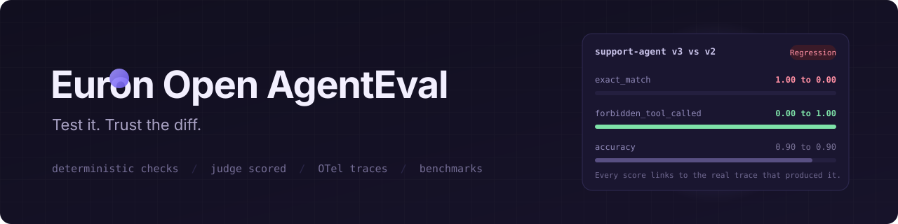
</p>

<p align="center">
  
  <a href="LICENSE"></a>
  
  
  
  
  
  
  
</p>

<p align="center">
  <a href="https://github.com/euron-sde-team/euron-open-agenteval/stargazers"></a>
  <a href="https://github.com/euron-sde-team/euron-open-agenteval/fork"></a>
  <a href="https://github.com/euron-sde-team/euron-open-agenteval/watchers"></a>
  <br>
  <a href="https://github.com/euron-sde-team/euron-open-agenteval/issues"></a>
  <a href="https://github.com/euron-sde-team/euron-open-agenteval/pulls"></a>
  <a href="https://github.com/euron-sde-team/euron-open-agenteval/commits/main"></a>
  
  <br>
  <a href="#built-by-the-team-behind-euron"></a>
</p>

<p align="center">
  <b><a href="#-quickstart">Quickstart</a></b> ·
  <b><a href="#️-architecture">Architecture</a></b> ·
  <b><a href="#-explore-the-repository">Explore the repo</a></b> ·
  <b><a href="#-use-the-sdk">SDK</a></b> ·
  <b><a href="docs/api/openapi.yaml">API reference</a></b> ·
  <b><a href="#️-deploy-to-aws">Deploy</a></b> ·
  <b><a href="#-security-model">Security</a></b> ·
  <b><a href="#-documentation">Docs</a></b>
</p>

**Euron Open AgentEval** is an open-source, MIT-licensed, self-hosted platform for scoring
AI agents, part of the open-source initiative of **ENGAGESPHERE TECHNOLOGY PRIVATE
LIMITED**. It runs an agent against a reusable dataset of test cases, scores each run with
deterministic checks first and rubric-based judge scoring second, never an LLM's opinion
alone, and keeps every run's score next to the trace that produced it, so a regression from
the last model or prompt version is a diff on a screen, not a guess.

- **Scores before it judges.** Exact match, regex, JSON schema validation, required and
  forbidden tool calls all run with zero model calls; a judge model only scores what
  cannot be checked deterministically (faithfulness, instruction adherence, open-ended
  accuracy).
- **Never one bare number.** Every metric is reported separately, with its method
  (deterministic or judge scored), its rubric version, and the judge's raw response,
  visible on the same screen as the score, never collapsed into a single hidden
  "intelligence score."
- **Guards against the judge's own bias.** A judge from the same provider family as the
  agent under test is flagged on the result, a structural mitigation for self-preference
  bias, not a prompt asking the judge to "be fair," which research shows does nothing
  measurable.
- **One scored run is one trace.** Every evaluation's execution uses OpenTelemetry GenAI
  semantic-convention spans, and a score always offers its matching trace, never a
  separate tool a team has to stitch together by hand.
- **Regression is a diff, not a vibe.** Compare any two completed runs of the same agent
  and dataset and get a per-metric delta with a configurable regression threshold, or
  chart a metric's trend across a run history.

The whole stack runs on a laptop against an AWS emulator, and deploys to AWS from the same
Terraform.

<p align="center">
  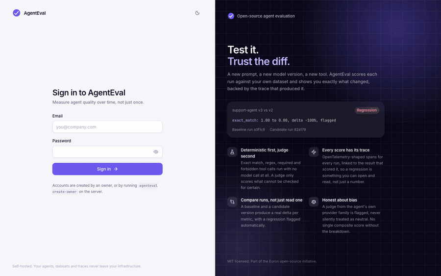
</p>

> [!NOTE]
> Everything in the tour ran for real: Docker Compose on a laptop, with a real agent
> (`support-triage-agent`) registered and run through two real evaluations the demo seed
> runs through the actual worker and evaluator engine, never a fabricated row. The
> benchmarks screen shows the genuine result: an `exact_match` regression (100% to 0%)
> and a `forbidden_tool_called` improvement (0% to 100%) between the two seeded versions.
> `make up && make demo` reproduces it.

<h3 align="center">Built by the team behind Euron</h3>

<p align="center">Euron Open AgentEval comes from the people who build these platforms. If you like how this repository is built, come and see what we build with it.</p>

<p align="center">
  <a href="https://euron.one"><picture><source media="(prefers-color-scheme: dark)" srcset="docs/assets/brand/euron-dark.svg"></picture></a>
  <a href="https://euronsystems.com"><picture><source media="(prefers-color-scheme: dark)" srcset="docs/assets/brand/euron-systems-dark.svg"></picture></a>
  <a href="https://alphaeuron.com"><picture><source media="(prefers-color-scheme: dark)" srcset="docs/assets/brand/alpha-euron-dark.svg"></picture></a>
</p>

<p align="center">
  <a href="https://www.instagram.com/euron_official"></a>
  <a href="https://www.linkedin.com/company/euronone/posts/"></a>
  <a href="https://x.com/euron712"></a>
  <a href="https://www.youtube.com/@Euron-official"></a>
  <a href="https://whatsapp.com/channel/0029VaeeJwq9RZAfPW9P2l07"></a>
</p>

---

## 📚 Table of contents

- [Why AgentEval](#-why-agenteval)
- [At a glance](#-at-a-glance)
- [Screenshots](#️-screenshots)
- [Features](#-features)
- [Architecture](#️-architecture)
  - [Life of an evaluation run](#life-of-an-evaluation-run)
- [Tech stack](#-tech-stack)
- [Prerequisites](#-prerequisites)
- [Quickstart](#-quickstart)
- [Explore the repository](#-explore-the-repository)
- [Use the SDK](#-use-the-sdk)
- [Configuration](#️-configuration)
- [Deploy to AWS](#️-deploy-to-aws)
- [Security model](#-security-model)
- [Testing](#-testing)
- [Documentation](#-documentation)
- [Roadmap](#️-roadmap)
- [FAQ](#-faq)
- [Contributing, security and license](#-contributing-security-and-license)

## 💡 Why AgentEval

A team ships a new prompt, a new model version, or a new tool, and has no repeatable way
to ask "did this make the agent better or worse." Testing by hand against a handful of
examples does not scale and does not repeat, and a single "intelligence score" from one
run is not evidence of anything, because the dataset, the model, the judge and the task
all change the number.

Researched against the rest of the category, not assumed: **DeepEval** and **Ragas** are
genuinely good scoring libraries, but neither has an execution-trace view of the run being
scored. **Langfuse** and **Arize Phoenix** trace agent runs well, but Langfuse does not
score at all, and Phoenix is source-available under the Elastic License, not OSI-approved
open source. **Promptfoo** is strong at prompt and model comparison, but its ownership is
reportedly shifting toward an acquirer, worth treating as a moving target rather than a
stable foundation. No tool in active use today combines scoring, the execution trace of
the scored run, and regression-over-time as one first-class object, under a genuinely
permissive license. **AgentEval's angle: one scored run is one trace plus one set of
metric results, and one agent's history is a graph of those over time.**

It also stays honest about what a score means: deterministic checks run first and need no
model call at all; a judge model is picked from a different provider family than the agent
under test by default, the one structural mitigation research supports against a judge
favoring its own model family's output; every score carries its rubric version and the
judge's raw response, never a bare number with no way to audit it; and the dashboard never
collapses every metric into one headline figure without the breakdown on the same screen.

## 📊 At a glance

| | |
| --- | --- |
| **Evaluation metrics** | 9: 5 deterministic (exact match, regex, JSON schema, required tool call, forbidden tool call) at zero model calls, plus 4 judge scored (task success, accuracy, faithfulness, instruction adherence), each rubric versioned |
| **Agent adapters** | 3: `http` (a deployed endpoint), `python` (a server-imported callable), `recorded` (the SDK runs a local callable and pushes a real OpenTelemetry trace for the worker to score) |
| **Traces** | OpenTelemetry GenAI semantic-convention spans for every evaluation, linked both ways with the result that scored them |
| **Benchmarking** | Pairwise comparison between any two runs with a per-metric delta and a configurable regression threshold, plus a trend view across a run history |
| **Dashboard** | 11 screens: Overview, Agents, Agent detail, Datasets, Dataset detail, Evaluations, Run detail, Execution traces, Benchmarks, Reports, Audit log, Settings, Sign in |
| **Backend domains** | 18, under `apps/api/src/agenteval/` (auth, orgs, agents, datasets, evaluations, evaluators, traces, benchmarks, audit, and more) |
| **Infrastructure** | 8 Terraform modules, 3 environments (local emulator, AWS dev, AWS prod); the full AWS stack applied end to end against Floci |
| **Tests** | 192 unit and integration (86 API, 13 API integration, 34 SDK, 59 dashboard), 9 browser end to end, a 36 combination browser QA sweep |
| **License** | MIT |

## 🖼️ Screenshots

<table>
  <tr>
    <td width="50%">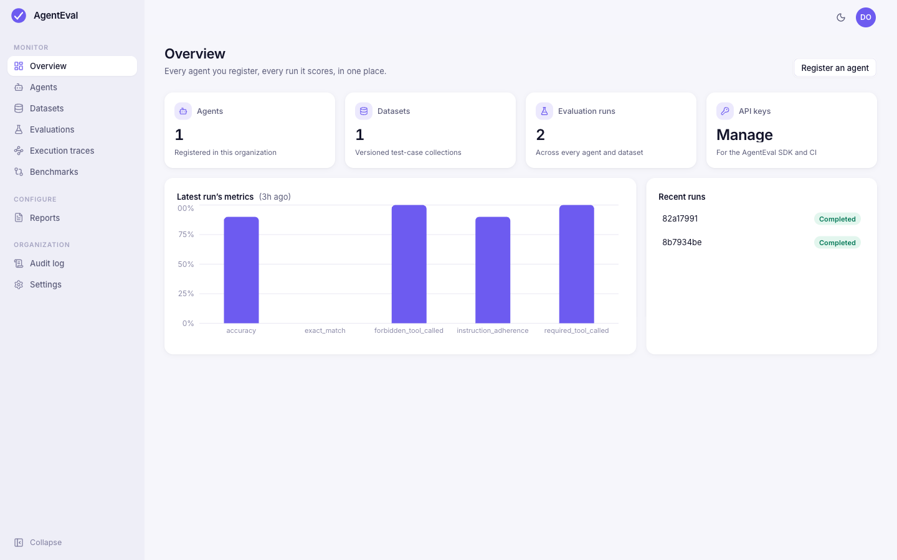<br><sub><b>Overview.</b> Registered agents, datasets, evaluation runs, the latest run's per-metric scores, and recent runs.</sub></td>
    <td width="50%">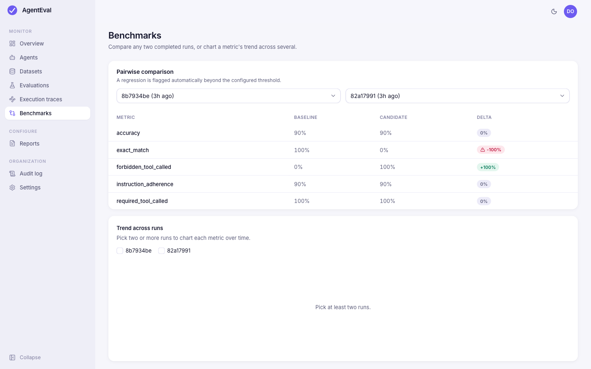<br><sub><b>Benchmarks.</b> A real pairwise comparison: an exact_match regression flagged, a forbidden_tool_called improvement, every other metric unchanged.</sub></td>
  </tr>
  <tr>
    <td>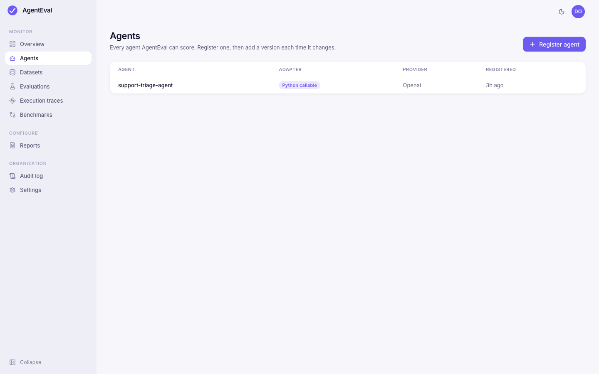<br><sub><b>Agents.</b> Every registered agent, its adapter type and provider.</sub></td>
    <td>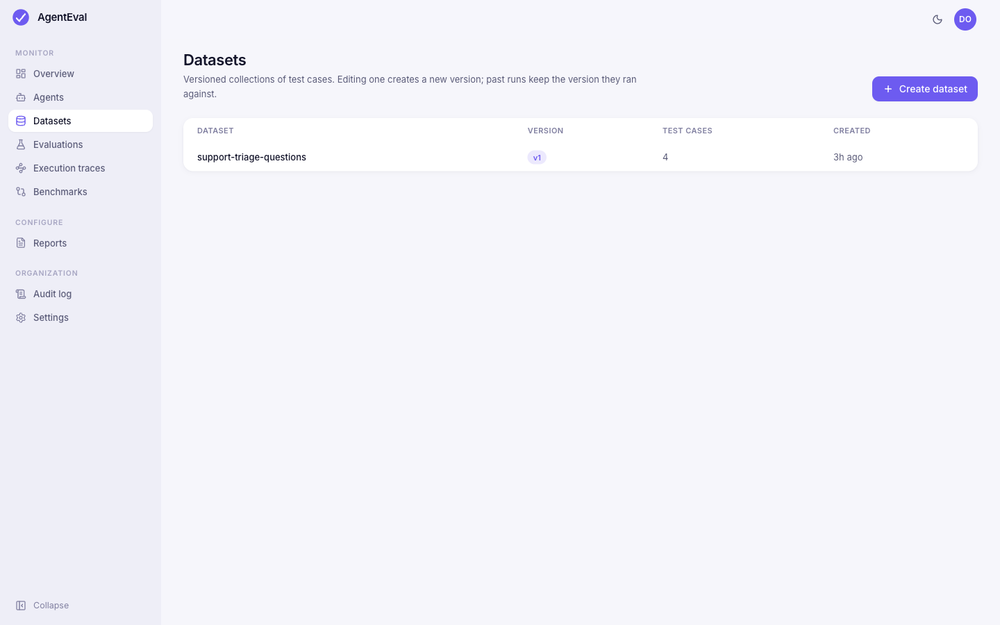<br><sub><b>Datasets.</b> Versioned test-case collections; editing creates a new version, old runs keep their original reference.</sub></td>
  </tr>
  <tr>
    <td>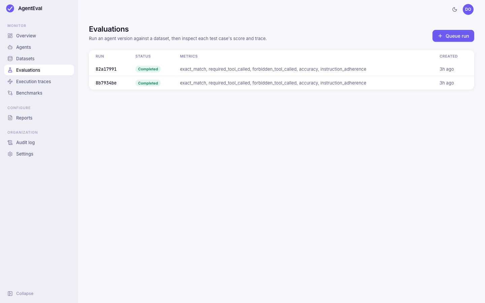<br><sub><b>Evaluations.</b> Every run, its agent version, dataset version and status.</sub></td>
    <td>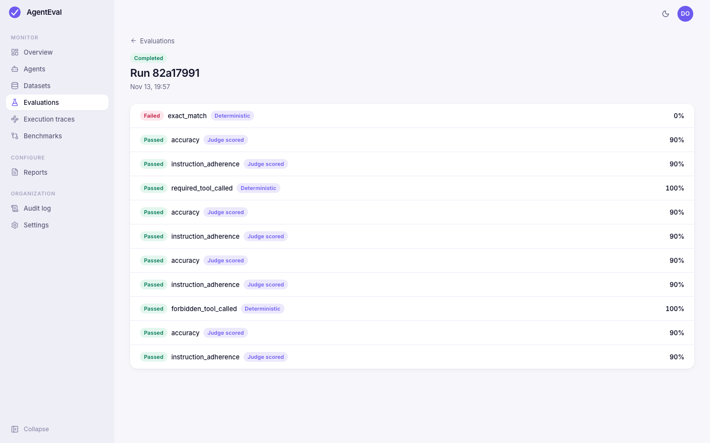<br><sub><b>Run detail.</b> Every test case's result, labeled deterministic or judge scored, never hidden behind one composite number.</sub></td>
  </tr>
  <tr>
    <td>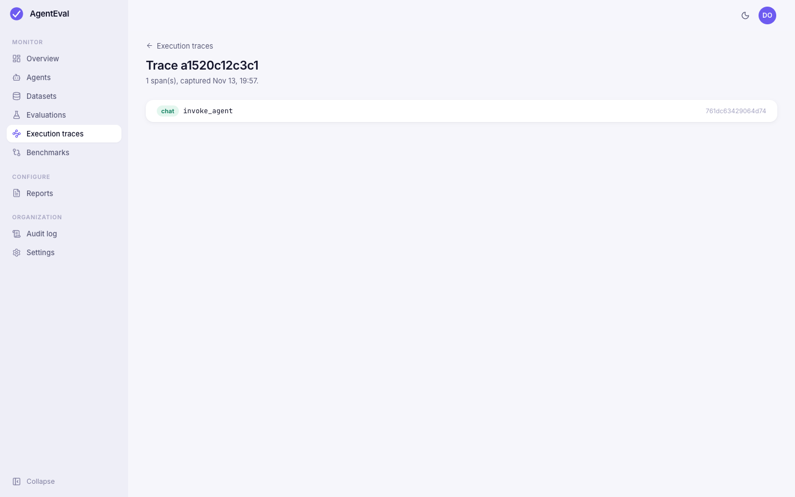<br><sub><b>Execution trace.</b> The real OpenTelemetry GenAI spans behind one evaluation, linked back to its result.</sub></td>
    <td>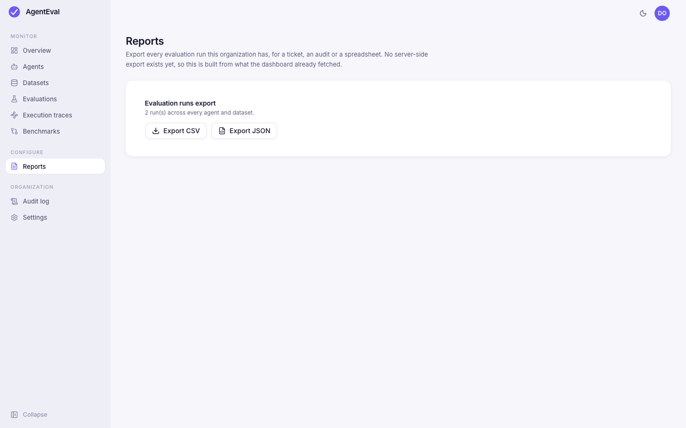<br><sub><b>Reports.</b> Export a run's results as CSV or JSON.</sub></td>
  </tr>
  <tr>
    <td>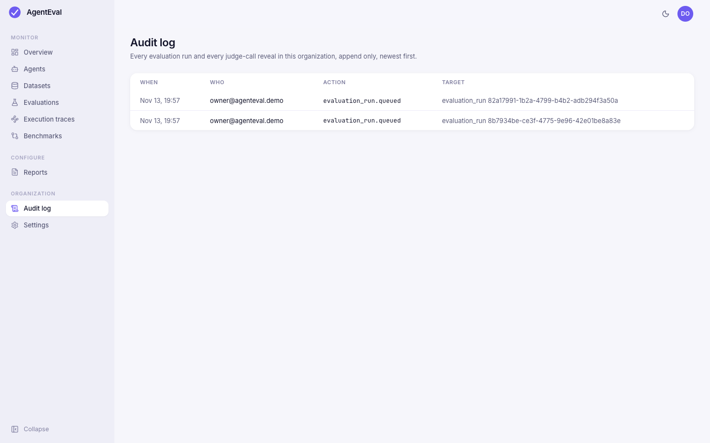<br><sub><b>Audit log.</b> Every evaluation run and every judge-response reveal, who and when.</sub></td>
    <td>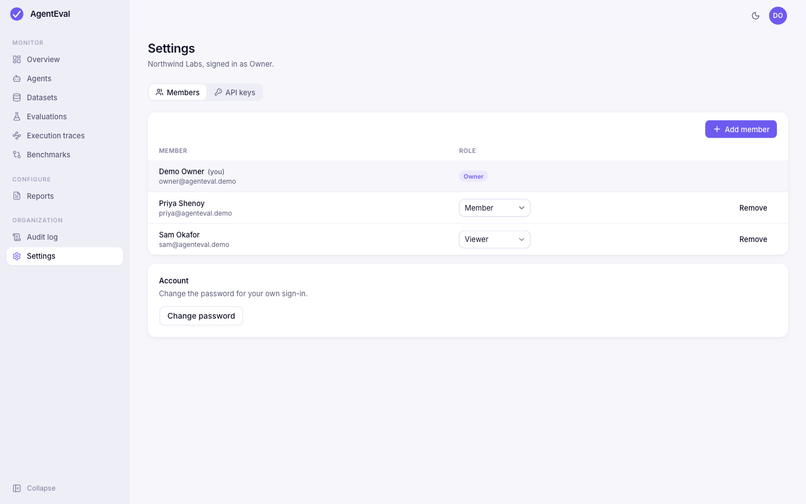<br><sub><b>Settings.</b> Members and roles, API keys for the SDK and CI.</sub></td>
  </tr>
  <tr>
    <td>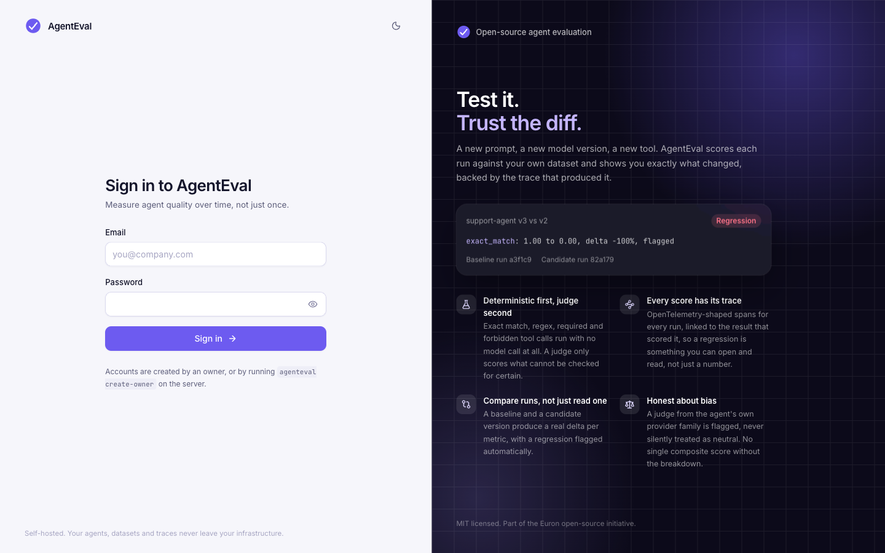<br><sub><b>Sign in.</b> Dashboard accounts with owner, admin, member and viewer roles.</sub></td>
    <td>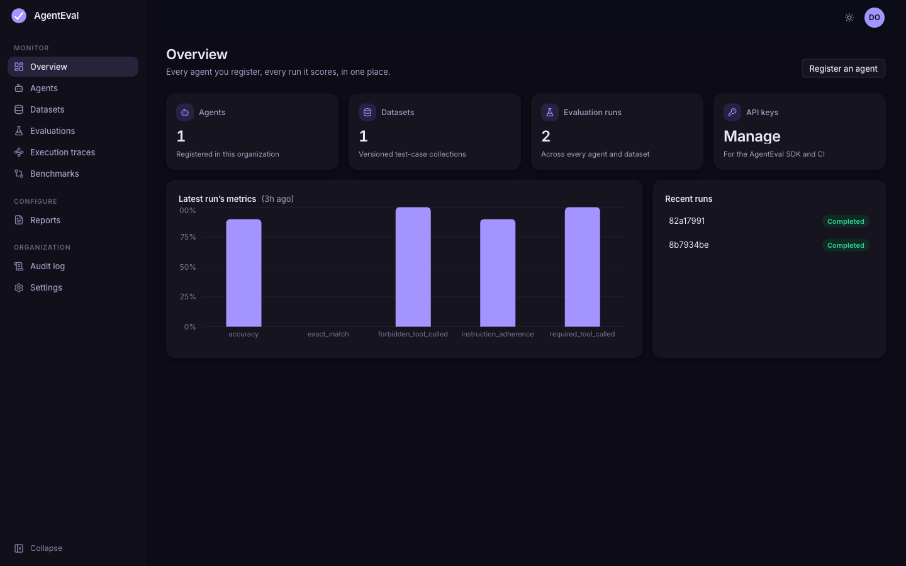<br><sub><b>Dark mode.</b> Every screen, in both themes.</sub></td>
  </tr>
  <tr>
    <td align="center" colspan="2">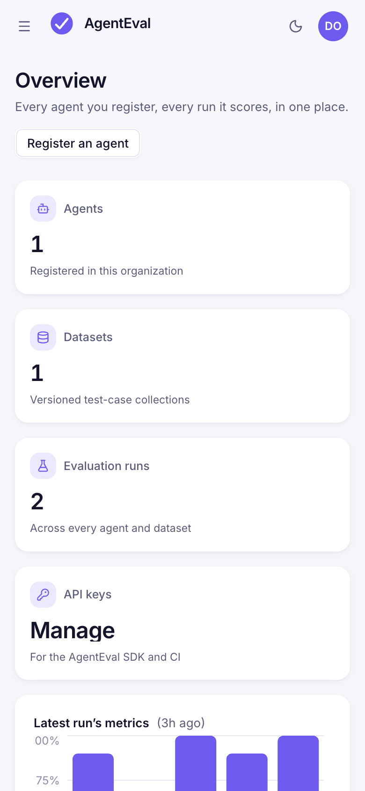<br><sub><b>Phone.</b> Responsive down to phone width.</sub></td>
  </tr>
</table>

## ✨ Features

<table>
<tr>
<td valign="top" width="50%">

#### ✅ Evaluation engine
- **Deterministic checks first**: exact match, regex, JSON schema validation, required
  and forbidden tool call, each at zero model calls, proven by call count in the test
  suite.
- **Judge-scored metrics second**: task success, accuracy, faithfulness, instruction
  adherence, only for what cannot be checked deterministically.
- **Every rubric is versioned**, and every judge call's raw response is stored for audit,
  so a later rubric change can never silently reinterpret an old score.
- **Same-family bias warning**: a judge from the same provider family as the agent under
  test is flagged on the result, never silently treated as neutral.

</td>
<td valign="top" width="50%">

#### 🧩 Agents and datasets
- **Three adapter types**: `http` for a deployed endpoint, `python` for a server-imported
  callable, `recorded` for a local callable the SDK runs itself and pushes a real trace
  for.
- **Agent versions**, so a benchmark compares specific versions, not just whichever is
  latest.
- **Versioned datasets**: editing a test case creates a new version, and a past run keeps
  a reference to the exact version it ran against.

</td>
</tr>
<tr>
<td valign="top">

#### 🔭 Execution traces
- **OpenTelemetry GenAI semantic-convention spans** for every evaluation, the same
  `gen_ai.*` attribute namespace the sibling project AgentDebugger uses, never a bespoke
  schema.
- **Linked both ways**: a score always offers its trace, and a trace always offers its
  score.
- **Tool-calling accuracy** scored from the trace's own recorded tool-call spans, never
  by re-parsing the agent's free-text output.

</td>
<td valign="top">

#### 📈 Continuous benchmarking
- **Pairwise comparison** between any two completed runs: a per-metric delta and a
  configurable regression threshold.
- **Trend across a run history**, not just the latest pair.
- **A metric present on only one side is skipped, never scored zero**, so adding or
  removing a metric between versions is never mistaken for a regression.

</td>
</tr>
<tr>
<td valign="top">

#### 📊 Efficiency and audit
- **Tokens, latency and step count** per run, from the same trace the quality metrics
  score, never a separately maintained total.
- **Append-only audit log** for every evaluation run and every judge-response reveal.

</td>
<td valign="top">

#### 🛠️ SDK and ops
- **Python SDK and CLI**: `evaluator.evaluate(agent=..., dataset=..., metrics=[...])`, or
  `agenteval-cli evaluate run` from the terminal, both OpenTelemetry instrumented.
- **A mock AI/LLM provider** makes judge scoring deterministic in development, tests and
  the demo, speaking the same real request shapes a provider does.
- **`/healthz`, `/readyz`, `/metrics`**, structured JSON logs.

</td>
</tr>
</table>

## 🏗️ Architecture

<p align="center">
  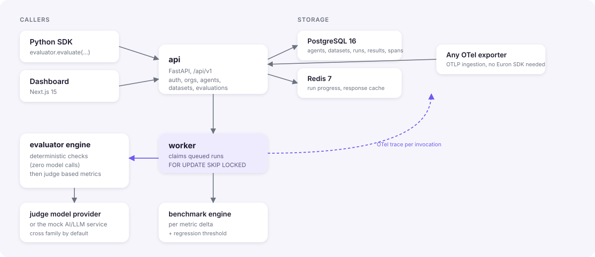
</p>

One Python package `agenteval` with process roles: `agenteval serve` (the admin API),
`agenteval worker` (claims and runs evaluations), `agenteval migrate`, `agenteval
seed-demo`. The evaluator engine (`agenteval.evaluators`) is a shared library the API,
worker and SDK all import, so a run scored locally through the SDK's `recorded` adapter and
a run executed by the worker apply byte-identical scoring logic.

### Life of an evaluation run

1. **Queue**: an evaluation run is inserted with its agent version, dataset version and
   requested metrics, and claimed by a worker with `FOR UPDATE SKIP LOCKED`, so multiple
   worker replicas never claim the same run twice. A `recorded` adapter run starts as
   `pending_traces` and only becomes claimable once the SDK has pushed every test case's
   trace, avoiding a race between the SDK and the worker's claim loop.
2. **Invoke**: for each test case, the worker calls the registered agent through its
   adapter (an HTTP request, an imported Python callable, or the SDK's own pushed trace for
   a `recorded` agent) and captures the invocation as OpenTelemetry GenAI-shaped spans.
3. **Score**: every configured metric's deterministic check runs first, with no model
   call; a judge-based metric only runs for what cannot be checked deterministically,
   building a rubric-versioned prompt and recording the judge's raw response.
4. **Write**: one `EvaluationResult` row per test case per metric, each pointing at the
   span or spans it scored, so a result and its trace are never separate objects.
5. **Compare** (on demand): a `BenchmarkComparison` between any two completed runs of the
   same agent and dataset lineage computes each metric's delta and flags a regression
   beyond a configurable threshold; the same computation across a run history renders as
   a trend.

## 🧰 Tech stack

| Layer | Technology |
| --- | --- |
| API, worker, evaluator engine | Python 3.12, FastAPI, Pydantic v2, SQLAlchemy 2 (async, asyncpg), Alembic, OpenTelemetry, httpx |
| Dashboard | Next.js 15 (App Router), React 19, TypeScript, Tailwind CSS 4, TanStack Query, Recharts, next-themes |
| SDK and CLI | Python 3.12, Click, httpx, OpenTelemetry, the same `agenteval` package the API and worker import |
| Data | PostgreSQL 16, Redis 7 |
| AWS | ECS Fargate, ALB, RDS, ElastiCache, KMS, Secrets Manager, ECR, CloudWatch |
| Local | Docker Compose, Floci (AWS emulator), a deterministic mock AI/LLM provider |
| Quality | pytest, Vitest, Playwright, Puppeteer, ruff, mypy `--strict`, ESLint, tflint, checkov |

## 📋 Prerequisites

- Docker with Compose v2
- `make`, `bash`
- For development outside containers: Python 3.12 with [uv](https://docs.astral.sh/uv/),
  Node 20+ and pnpm 9 (`corepack enable`)

## 🚀 Quickstart

```bash
git clone https://github.com/euron-sde-team/euron-open-agenteval.git
cd euron-open-agenteval
make up      # Postgres, Redis, Floci, the mock AI/LLM service, api, worker, web
make demo    # "Northwind Labs": a real agent, a dataset, two real evaluation runs; prints the logins
```

Open the dashboard at http://localhost:5710 and sign in with the printed credentials.
`make down` removes everything.

## 🧭 Explore the repository

```text
euron-open-agenteval/
├── apps/
│   ├── api/                   Python package: admin API, worker, evaluator engine, mock
│   │   └── src/agenteval/
│   │       ├── evaluators/        deterministic checks, judge-based metrics, the mock judge
│   │       ├── auth/ orgs/ api_keys/ audit/    control plane
│   │       ├── agents/ datasets/ evaluations/ traces/ benchmarks/    the core domains
│   │       ├── demo/              the demo seed (a real agent, dataset and two real runs)
│   │       ├── core/              config and boot guards, db, security
│   │       ├── migrations/        Alembic revisions
│   │       └── worker.py          the evaluation run claim loop
│   └── web/                    Next.js dashboard (features/<domain>, components, lib)
├── sdk/python/                 the AgentEval client and agenteval-cli
├── infra/
│   ├── terraform/               modules + envs (local-floci, aws-dev, aws-prod)
│   └── docker/                  api and web images
├── deploy/compose/              the local stack (Floci or real AWS overlay)
├── e2e/                          Playwright browser tests
├── scripts/                      QA sweep and screenshots, sanitization check, tf-aws-on-floci
└── docs/                         the build plan, OpenAPI, screenshots and diagrams
```

## 🔌 Use the SDK

A standalone package (`sdk/python`) depending on the same `agenteval` package the API and
worker use, so the SDK's dataclasses and span shapes are always the real ones the server
scores against, never a hand-copied duplicate.

```python
from agenteval_sdk import AgentEval

evaluator = AgentEval(api_url="http://localhost:5730", api_key="aek_...", org_id="...")

result = evaluator.evaluate(
    agent="my_pkg.agent:answer",   # or an http:// endpoint URL, or a local callable
    dataset="customer-support-tests",
    metrics=["exact_match", "task_success"],
)
print(result.summary())
```

The CLI mirrors the same client:

```bash
agenteval-cli init
agenteval-cli agent add
agenteval-cli dataset create
agenteval-cli evaluate run
agenteval-cli compare
agenteval-cli report export
```

Passing a live Python callable (rather than an import path or a URL) runs it locally, in
your own process, and pushes a real OpenTelemetry trace of the call to the server as a
`recorded` adapter run, since a live object cannot be handed to a remote worker to import.

## ⚙️ Configuration

All settings are environment variables, validated at boot. The most important:

| Variable | Default | |
| --- | --- | --- |
| `SESSION_SECRET` | *(required)* | Signs dashboard session tokens |
| `API_KEY_PEPPER` | *(required)* | Peppers API key hashes at rest |
| `MOCK_AI_URL` | unset | Points judge scoring at the mock instead of a real provider origin |
| `COOKIE_SECURE` | `true` | Set `false` for local HTTP development only |
| `AE_DEMO_PASSWORD` | a generated value | The password `make demo` creates its three demo users with |

Generated once per clone by `make env` into the gitignored `deploy/compose/.env`.

## ☁️ Deploy to AWS

```bash
cd infra/terraform/envs/aws-dev        # or aws-prod
cp terraform.tfvars.example terraform.tfvars
terraform init && terraform apply -target=module.ecr
# build and push the api and web images, then:
terraform apply
```

This creates a VPC, RDS PostgreSQL, ElastiCache, a KMS key, Secrets Manager entries, ECR,
ECS Fargate services behind an ALB, and CloudWatch alarms. The maintainers develop against
the local emulator; the AWS environments pass `terraform validate`, tflint and checkov, and
the full `aws-dev` stack is planned, applied, re-planned and destroyed against Floci
(`make tf-aws-on-floci`) on every infrastructure change.

## 🔐 Security model

| Area | How |
| --- | --- |
| Dashboard sessions | argon2 password hashing, JWT session tokens scoped to this dashboard's own audience |
| API keys | `aek_<prefix>_<secret>`, stored as a peppered HMAC, shown once, org-scoped role, revocation leaves an audit record instead of disappearing |
| Judge calls | A found credential or secret is never part of a judge prompt by design; every judge call's raw response is stored for audit, never silently discarded |
| Judge bias | A judge from the same provider family as the agent under test is flagged on the result, never silently treated as a neutral score |
| Tenant isolation | An organization you cannot see returns 404, never 403, for every agent, dataset, evaluation run and trace under it |
| Infrastructure | Private subnets, KMS encryption, least-privilege task roles, checkov clean |

Report vulnerabilities privately: see [SECURITY.md](SECURITY.md).

## 🧪 Testing

| Suite | What it proves | Run |
| --- | --- | --- |
| Unit (86 API, 34 SDK, 59 dashboard) | Deterministic checks against pass and fail cases, judge metric prompt construction and rubric versioning, cross-family judge detection, OpenTelemetry span mapping, benchmark delta and regression-threshold computation, agent adapter dispatch, config boot guards, dashboard logic and components | `make test` |
| Integration (13) | The real API against Postgres, Redis and the mock AI/LLM service: every endpoint and role, an evaluation run end to end with zero judge calls for deterministic-only test cases, a judge metric's rubric version and raw response stored and retrievable, the same-family bias warning, tool-calling accuracy from real spans, a benchmark comparison's delta and regression flag, dataset version pinning, tenant isolation | `make test-integration` |
| Browser (9) | Sign in, register an agent and run an evaluation to completion, a result's method breakdown and its judge-response reveal, its linked execution trace, the real benchmark comparison and trend, the API key lifecycle, member management, tenant isolation for a second organization | `make e2e` |
| Browser QA | Every page in light and dark at desktop and phone width: no console errors, failed requests, broken images or overflow | `make qa` |
| Infrastructure | `terraform validate` (3 environments), tflint, checkov (252 passed, 0 failed), sanitization (secrets, account ids, em and en dashes) | `make tf-validate tf-lint tf-security sanitize` |
| AWS on Floci | The full `aws-dev` environment (139 resources: VPC, RDS, ElastiCache, ECS Fargate, ALB, KMS, Secrets Manager, ECR, CloudWatch) plans, applies, converges and destroys against an AWS API | `make tf-aws-on-floci` |

## 📖 Documentation

- [Build plan](docs/PLAN.md): purpose, acceptance criteria, scope, evaluation methodology, architecture, data model
- [API reference (OpenAPI)](docs/api/openapi.yaml)
- [Contributing](CONTRIBUTING.md), [Security policy](SECURITY.md), [Changelog](CHANGELOG.md)

## 🗺️ Roadmap

A few things from the original scope are deliberately not in 0.1.0, alongside genuine
stretch goals:

- **Registering a custom evaluator through the API or dashboard.** The scoring path for
  a rubric-only custom metric exists in the evaluator engine and the data model supports
  an organization-scoped metric row, but there is no endpoint yet to create one, so this
  is not an end-to-end feature in 0.1.0.
- RAG evaluation (retrieval precision and recall, context relevance, chunking and
  embedding comparison)
- Multi-agent evaluation (delegation accuracy, coordination scoring)
- Security and safety evaluation (prompt injection, jailbreak resistance, policy
  compliance red-teaming)
- First-party framework adapters (LangChain, LangGraph, CrewAI, AutoGen, LlamaIndex,
  OpenAI Agents SDK) beyond the generic OpenTelemetry, HTTP and Python adapters
- Synthetic test-case generation
- A TypeScript SDK
- CI/CD-native integrations (GitHub Actions) beyond the generic CLI and API
- Pluggable DeepEval or Ragas backend evaluators
- A hosted evaluation infrastructure tier
- SSO (OIDC) for the dashboard

Have an idea? [Open a feature request](https://github.com/euron-sde-team/euron-open-agenteval/issues/new/choose).

## ❓ FAQ

<details>
<summary><b>Do I need an AWS account or a real LLM provider key to try it?</b></summary>

No. `make up` runs everything on Docker, with an AWS emulator provisioned by the same
Terraform modules as production, and a deterministic mock AI/LLM service so judge scoring
works with no real provider key, no network access and no cost.
</details>

<details>
<summary><b>Does AgentEval claim to measure an agent's intelligence?</b></summary>

No. A score is relative to its dataset, evaluator version and judge model, and is for
comparing runs of the same configuration over time, never for ranking unrelated agents.
The dashboard never shows a single composite score as the headline without the per-metric
breakdown on the same screen.
</details>

<details>
<summary><b>How does AgentEval avoid a judge favoring its own model family?</b></summary>

By default the judge model is a different provider family than the agent under test. If
you configure a same-family judge anyway, the result is flagged with a visible warning,
never silently treated as a neutral score. Asking a judge prompt to "be fair" has no
measurable effect against this bias; only a structural mitigation does.
</details>

<details>
<summary><b>What happens if I edit a dataset after I have already run evaluations against it?</b></summary>

Editing a test case creates a new dataset version. Every past evaluation run keeps a
reference to the exact version it actually ran against, so editing a dataset never
silently changes what a historical score means.
</details>

<details>
<summary><b>Can I run an evaluation against a local Python function without deploying it anywhere?</b></summary>

Yes. Pass a live callable to the SDK's `evaluate()` and it runs locally, in your own
process, pushing a real OpenTelemetry trace of each call to the server as a `recorded`
adapter run, so the server scores from the real trace, never a re-parsed guess at what
happened.
</details>

<details>
<summary><b>Can a member of one organization see another organization's data?</b></summary>

No. Every agent, dataset, evaluation run and trace is scoped to one organization, and a
request for something outside it returns a plain 404, the same response as if it did not
exist at all, never a 403 that would confirm it does.
</details>

## 🤝 Contributing, security and license

Contributions are welcome: read [CONTRIBUTING.md](CONTRIBUTING.md) and the
[code of conduct](CODE_OF_CONDUCT.md). Report security issues privately as described in
[SECURITY.md](SECURITY.md).

Released under the [MIT License](LICENSE). Copyright (c) 2026 ENGAGESPHERE TECHNOLOGY
PRIVATE LIMITED and the Euron Open AgentEval contributors.

<p align="center">
  If AgentEval helps you trust a diff, <b><a href="https://github.com/euron-sde-team/euron-open-agenteval/stargazers">⭐ star the repository</a></b>.
</p>
